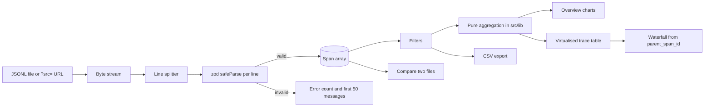

# Trace Explorer

A browser-only explorer for LLM trace files. Drop in a JSONL file of spans and see where the time
and the money went: totals, latency percentiles, cost by model and feature, a span waterfall for
every trace, filters, a before/after comparison and CSV export. There is no backend and no
telemetry. Files are read in your browser and never uploaded.

Live demo (after the owner enables GitHub Pages): `https://<owner>.github.io/trace-explorer/`

## Problem

The `llmops` tooling writes one JSON line per span (an LLM call, a retrieval, a tool call, a cache
lookup). Engineers need to answer questions such as "why did p95 go up" or "which feature costs
the most" without standing up a server or a database. Trace Explorer makes that a drag-and-drop
job, and it stays responsive on 100k spans.

## Input format

One JSON object per line:

```json
{
  "trace_id": "uuid",
  "span_id": "uuid",
  "parent_span_id": null,
  "name": "generate",
  "kind": "llm",
  "start_ts": "2026-10-15T10:00:00.000Z",
  "end_ts": "2026-10-15T10:00:00.812Z",
  "latency_ms": 812.4,
  "model": "anthropic/claude-sonnet-4.5",
  "input_tokens": 1332,
  "output_tokens": 60,
  "cost_usd": 0.0049,
  "cache_hit": false,
  "feature": "rag.answer",
  "user_id": "u012",
  "session_id": null,
  "status": "ok",
  "error_kind": null,
  "meta": {}
}
```

`kind` is one of `llm`, `retrieval`, `rerank`, `tool`, `cache`, `verify`, `other` (other values are
kept). Optional fields have defaults. A line that is not valid JSON or fails validation is counted
and skipped; the app shows how many lines were skipped and why.

## Architecture



All logic lives in pure functions under `src/lib/` (parse, stats, waterfall, filters, csv,
compare) with unit tests. React components only render. State is a small zustand store.

## Features

- **Load**: drag and drop anywhere, a file picker, a bundled sample, or `?src=<url>` to fetch a
  JSONL over HTTP (the server must allow CORS). That fetch is the only network request the app can
  make, and only when you ask for it.
- **Overview**: spans, traces, cost, tokens, error rate, cache-hit rate, p50/p95/p99 latency, cost
  by model and by feature, latency by span kind, requests over time.
- **Traces**: virtualised, sortable table. Search plus feature, model, status, kind and UTC time
  range filters. Click a row for the waterfall, a metadata panel and copy-as-JSON for a span or the
  whole trace.
- **Compare**: load a second file for a before/after table with the same columns and definitions as
  `llmops compare`, downloadable as Markdown.
- **Export**: the current filtered view as CSV (cells that start with `=`, `+`, `-` or `@` are
  prefixed with an apostrophe so spreadsheets do not run them).
- **Accessibility**: keyboard navigable, visible focus, skip link, labelled charts, light and dark
  themes that follow `prefers-color-scheme` with a manual toggle.

## Run it

Requires Node 22 or newer (developed on Node 26).

```bash
npm ci
npm run dev          # development server
npm run build        # production build into dist/
npm run preview      # serve dist/ locally

npm run lint         # ESLint
npm run format:check # Prettier
npm run typecheck    # tsc, strict
npm test             # Vitest unit and component tests
npx playwright install chromium   # once
npm run e2e          # Playwright end-to-end tests with axe checks (builds and serves the app)
npm run bench        # regenerates reports/bench.json, reports/bench.md and the table below
```

Deploying under a sub-path:

```bash
VITE_BASE=/trace-explorer/ npm run build
```

`.github/workflows/pages.yml` does this on every push to `main` and uploads a Pages artifact. The
owner has to enable Pages (source: GitHub Actions) in the repository settings.

## Results

Every row is produced by `npm run bench`; nothing here is typed by hand. Parse figures come from
Node, "load to first table row" is measured in headless Chromium, test counts come from the Vitest
and Playwright JSON reports, and axe violations come from `reports/axe.json` written by the e2e
run.

<!-- prettier-ignore-start -->
<!-- bench:start -->
| Metric | Result |
| --- | --- |
| Parse throughput (sample, 3.9k spans) | 192,765 spans/s (95.3 MB/s, median of 9 runs) |
| Parse + validate 100k spans | 624.5 ms (162,947 spans/s) |
| Aggregate 100k spans (traces + overview) | 105.9 ms |
| Filter 100k spans | 21.4 ms |
| Load to first table row, 100k spans (Chromium, median of 3) | 0.87 s |
| Bundle size, gzip (all assets) | 229.8 kB |
| Bundle size, gzip (initial load) | 123.1 kB |
| Unit tests (Vitest) | 43 passed, 0 failed |
| E2E tests (Playwright) | 11 passed, 0 failed |
| axe violations (WCAG 2.1 AA) | 0 across 8 view states |

Generated by `npm run bench` on 2026-11-06 (Node v26.5.0, AMD Ryzen AI 7 350 w/ Radeon 860M).
<!-- bench:end -->
<!-- prettier-ignore-end -->

"Load to first table row" is the time from handing a 100k-span file (53 MB) to the file input
until the first row of the virtualised table is on screen. It is not Lighthouse TTI.

## Sample data

`public/samples/` holds two synthetic trace files copied from the sibling `llm-evalops` repository.
See `public/samples/README.md` for their origin. They are generated, not real model calls.

## Known limitations

- Everything is parsed on the main thread. A 100k-span file parses in a fraction of a second, but
  a multi-million-span file would freeze the tab (see design note 5).
- Filters are single-select per field (plus search and a time range), not multi-select.
- The Compare view always uses the full files; the Overview and Traces filters do not apply to it.
- Error rate on the Overview is per trace (any span with `status: error`), while Compare uses root
  spans to match `llmops compare`. The two can differ.
- Time filters and displayed times are UTC.
- `?src=` needs a server that sends CORS headers. A failed fetch shows an error message.
- The bundled samples add about 4.5 MB to the deployed site.
- Lighthouse CI is not set up. The workflows were written for GitHub Actions but could not be run
  on this machine; the same commands were run locally.
- TanStack Table is pinned to v8, whose API is stable.

## Design notes

**1. Why client-only.** Trace files contain prompts, user ids and cost data. A static site that
never uploads anything removes the privacy review, the hosting cost and the on-call burden. The
price is that all work happens on the user's machine, which is fine up to the low millions of
spans.

**2. Why zod per line with error tolerance.** Real trace files are written by many processes and
get truncated. Failing the whole file because of one half-written line makes the tool useless
exactly when you need it. Each line is parsed with `safeParse`; bad lines are counted, the first
50 messages are kept with their line numbers, and the UI says how many were skipped. Unknown
`kind` values and missing optional fields are accepted so the schema can grow.

**3. Virtualisation choices.** The trace table renders only the rows in view (TanStack Virtual
with a fixed 34 px row height and 12 rows of overscan), so 850 or 30,000 traces cost the same DOM.
Fixed row height keeps scrolling arithmetic trivial. The table uses ARIA `table` roles on divs
because virtualised rows are absolutely positioned; the scroll container is focusable so keyboard
users can reach it, and rows open on Enter or Space. The waterfall is not virtualised because a
single trace has tens of spans, not thousands.

**4. How the waterfall handles missing parents.** The tree is built from `parent_span_id`. A span
whose parent is not in the file becomes a root, is labelled "missing parent", and a note above the
chart counts them. Duplicate span ids keep the first span and are counted. A parent cycle cannot
loop forever: spans unreachable from any root are surfaced as flagged roots. When a trace has no
true root, its duration falls back to the extent of its spans.

**5. What I would add for multi-million-span files.** Move parsing and aggregation into a Web
Worker so the UI stays responsive, store columns in Apache Arrow typed arrays instead of one
object per span, build the trace index incrementally while streaming, and aggregate with
pre-bucketed histograms instead of sorting every latency. The pure functions in `src/lib/` have no
DOM dependency, so they would move into the worker unchanged.
